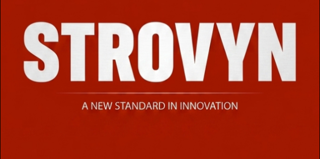
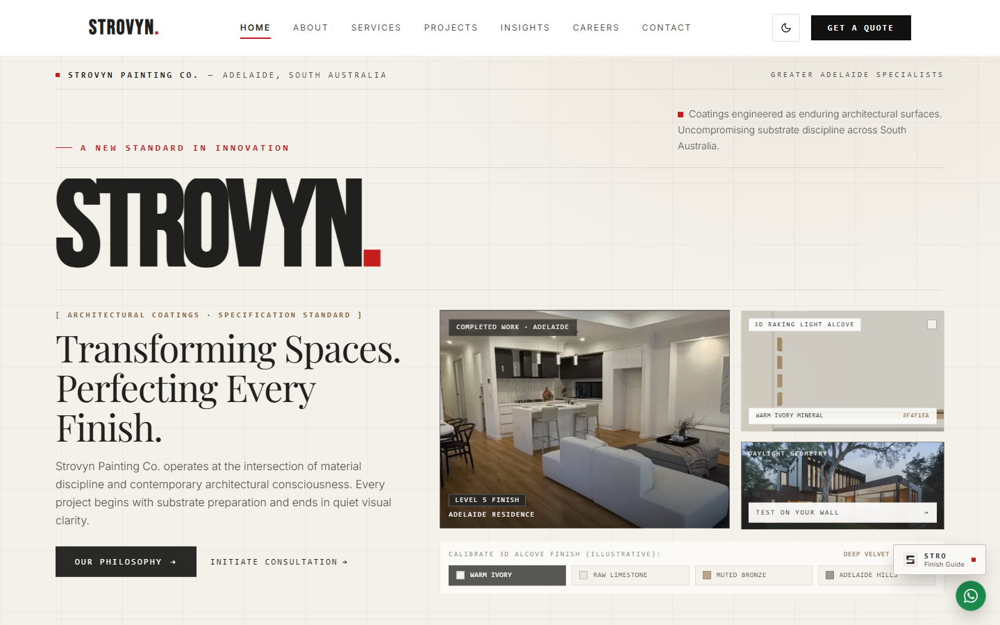
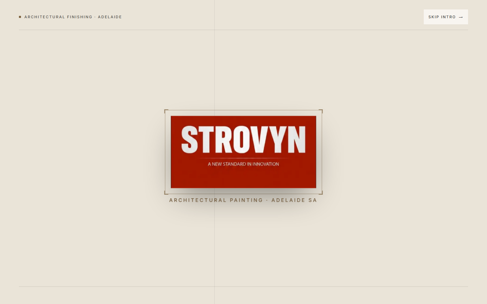
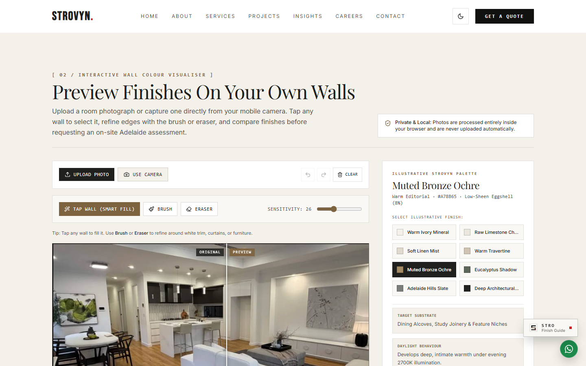
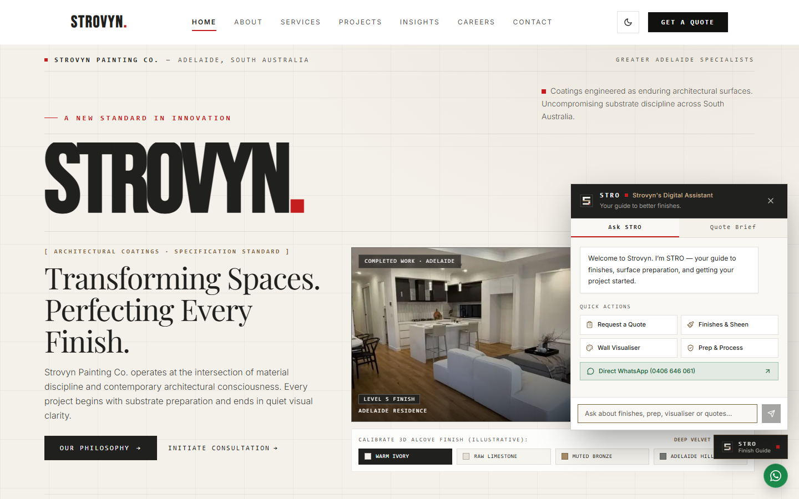
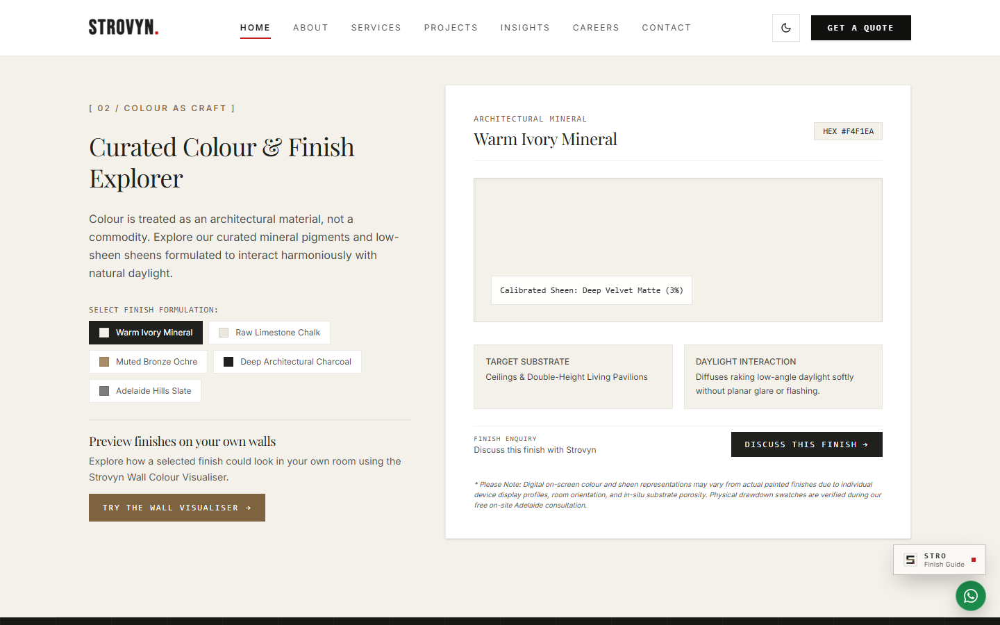
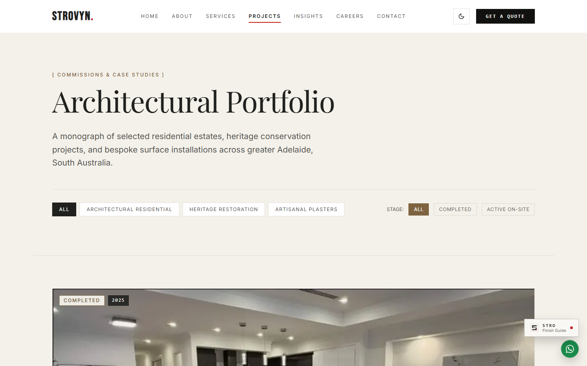
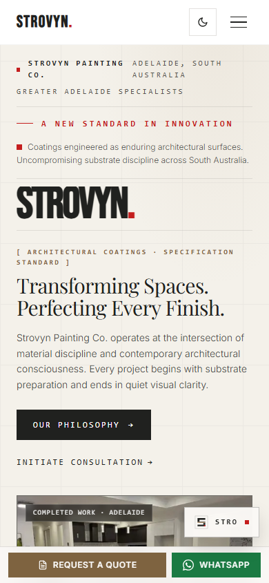

<div align="center">

<br />



<br />
<br />

# STROVYN PAINTING CO.

**Transforming Spaces. Perfecting Every Finish.**

*Architectural painting, substrate restoration, interactive 3D & colour visualisation, and guided project enquiries for Greater Adelaide, South Australia.*

<br />


<br />

[Overview](#project-overview) &nbsp;&middot;&nbsp;
[Screenshots](#website-screenshots) &nbsp;&middot;&nbsp;
[Features](#key-features) &nbsp;&middot;&nbsp;
[Tech Stack](#technology-stack) &nbsp;&middot;&nbsp;
[Architecture](#architecture-overview) &nbsp;&middot;&nbsp;
[Local Setup](#local-development) &nbsp;&middot;&nbsp;
[API Reference](#api-reference) &nbsp;&middot;&nbsp;
[Database & Security](#database-and-security) &nbsp;&middot;&nbsp;
[Visualiser](#wall-colour-visualiser) &nbsp;&middot;&nbsp;
[STRO AI](#stro-ai-assistant) &nbsp;&middot;&nbsp;
[Deployment](#deployment)

<br />



</div>

---

## Project Overview

**Strovyn Painting Co.** is a digital web platform engineered for an architectural painting and surface-finishing practice serving Greater Adelaide, South Australia.

Rather than a static brochure site, the platform pairs an architectural editorial aesthetic with interactive pre-consultation tools — allowing prospective clients to explore surface formulations in raking light, preview illustrative wall colours directly on photographs of their own rooms, consult with **STRO** (Strovyn's digital finishing guide), and submit structured quotation briefs with validation, upload verification, and deduplication safeguards.

### Website Capabilities vs. Verified Business Scope

To keep technical documentation clear and verifiable:

- **Confirmed Business Identity (`src/lib/constants.ts`)**: Strovyn Painting Co., operating across Adelaide, South Australia, with confirmed direct phone and WhatsApp contact (`0406 646 061` / `+61 406 646 061`) and consultations by appointment.
- **Website Engineering**: All UI interactions, client-side visualiser tools, AI intent guidance, and server API validation/idempotency layers are implemented in this repository; external persistence, private cloud file storage, email delivery, and live LLM generation activate when owner-supplied environment credentials are configured.

---

## Website Screenshots

<div align="center">

### 1. Three-Act Cinematic Brand Introduction & Official Identity Lockup


<br />

### 2. Interactive Wall Colour Visualiser (`/visualiser`) &nbsp;&middot;&nbsp; 3. STRO AI Digital Concierge
<table>
  <tr>
    <td width="50%" align="center">
      
      <br /><sub><strong>Wall Colour Visualiser</strong> — Sobel-guided Smart Fill, brush/eraser tools &amp; split before/after slider</sub>
    </td>
    <td width="50%" align="center">
      
      <br /><sub><strong>STRO AI Assistant</strong> — Dual-tab finishing guidance, guided quote brief &amp; WhatsApp handoff</sub>
    </td>
  </tr>
</table>

### 4. Finish Explorer &nbsp;&middot;&nbsp; 5. Architectural Portfolio (`/projects`)
<table>
  <tr>
    <td width="50%" align="center">
      
      <br /><sub><strong>Finish Explorer</strong> — Pigment sheen levels, substrate recommendations &amp; daylight behaviour</sub>
    </td>
    <td width="50%" align="center">
      
      <br /><sub><strong>Architectural Portfolio</strong> — Category and lifecycle filtering across completed &amp; active works</sub>
    </td>
  </tr>
</table>

### 6. Responsive Mobile Experience (`390×844`)


</div>

---

## Key Features

- **3-Act Cinematic Brand Ident (`src/components/intro/`)**: Plays automatically once per browser session on `/` (`sessionStorage.strovyn_intro_seen`), combining a dynamic WebGL sunlit plaster gallery backdrop (`IntroArchitecturalBackdrop.tsx`) with GSAP centerpiece logo choreography, immediate `Skip Intro` / `Escape` dismissal, keyboard focus discipline, and automatic bypass when `prefers-reduced-motion: reduce` is enabled.
- **Architectural Hero & 3D Raking-Light Alcove (`src/components/home/Hero.tsx`)**: Interactive `@react-three/fiber` alcove study (`HeroArchitecturalScene.tsx`) allowing visitors to toggle finish presets (*Warm Ivory*, *Raw Limestone*, *Muted Bronze*, *Adelaide Hills Slate*) under dynamic grazing light alongside completed Adelaide residence photography and a fallback gradient layer if WebGL is unavailable.
- **Responsive Navigation & Dual Theme (`src/components/layout/`)**: Light (`Warm Ivory #F4F1EA`) and Dark (`#20211F` charcoal) theme switcher persisted in `localStorage` (`strovyn-theme`), adaptive header contrast, mobile drawer menu, and honest inline footer legal-notice disclosures for unpublished policies (`/privacy`, `/terms`, `/cookies`).
- **Services, Projects & Insights (`src/app/services`, `/projects`, `/insights`)**: Structured finishing specifications across six architectural disciplines, interactive `BeforeAfterSlider` substrate comparison, category/stage filters on portfolio projects, and searchable architectural articles & FAQs.
- **Curated Colour & Finish Explorer (`src/components/home/FinishExplorer.tsx`)**: Evaluates sheen percentages (`1%` Dead Flat to `20%` Satin), LRV behaviour, and target substrates, linking visitors straight into `/visualiser` or prefilled `/contact` enquiries.
- **Wall Colour Visualiser (`/visualiser`)**: Client-side room photo recolouring workspace — documented in detail [below](#wall-colour-visualiser).
- **STRO AI Concierge & Quote Brief (`src/components/floating/AIAssistant.tsx`)**: Context-aware finishing guide and inline quotation builder — documented in detail [below](#stro-ai-assistant).
- **Enquiries, Uploads, Careers & Feedback (`/contact`, `/careers`, `/feedback`)**: Zod-validated submission forms with prefilled query-parameter handoff, private document/CV uploads (`/api/upload`), WhatsApp direct link (`0406 646 061`), and idempotent server persistence.
- **Authenticated Photo Manager (`/admin/photos`)**: Password-gated project media manager backed by HMAC-SHA256 signed cookies and CSRF origin checks.

---

## Technology Stack

Verified directly against [`package.json`](package.json) and repository source files:

| Category | Confirmed Technologies & Packages |
| --- | --- |
| **Frontend** | Next.js (`^16.4.6`, App Router, Turbopack, `cacheComponents`), React (`19.3.0`), TypeScript (`^5`), Lucide React (`^1.72.0`), self-hosted WOFF2 typography (`Playfair Display`, `Inter`, `Bebas Neue`) |
| **Styling & Motion** | Tailwind CSS (`4.3.3` via `@tailwindcss/turbopack`), CSS theme custom properties (`src/app/globals.css`), GSAP (`^3.15.1`), Framer Motion (`^12.43.0`) |
| **3D & Visualisation** | Three.js (`^0.187.0`), React Three Fiber (`9.8.2`), Drei (`10.7.9`), native HTML5 Canvas 2D pixel processing & Sobel edge detection |
| **Backend & API** | Next.js App Router Route Handlers (`src/app/api/*`) |
| **Database & Storage** | Supabase (`@supabase/supabase-js ^2.119.0`, `@supabase/ssr ^0.12.7`), PostgreSQL schema migrations (`supabase/migrations/`) |
| **AI & Notifications** | Google Gemini REST API (`gemini-2.0-flash`, optional via `AI_API_KEY`) with deterministic server fallback; Resend (`^6.38.0`) transactional email notifications |
| **Validation & Security** | Zod (`^4.6.7`), Node `crypto` (HMAC-SHA256 admin session tokens, timing-safe comparison, SHA-256 deduplication keys, magic-byte file signature checks) |
| **Testing & Tooling** | ESLint (`^9`, `eslint-config-next 16.4.6`), TypeScript compiler (`tsc --noEmit`), Node verification scripts (`scripts/`) |

---

## Architecture Overview

```text
strovyn-painting/
├── docs/
│   └── readme/                        # Authentic application screenshots embedded in this README
├── public/
│   ├── fonts/                         # Self-hosted Playfair Display, Inter & Bebas Neue WOFF2 fonts + licences
│   └── images/                        # Official Strovyn brand banner & verified Adelaide project photography
├── scripts/                           # Regulatory ingestion pipeline, concurrency/lock tests & API security smoke test
├── supabase/
│   └── migrations/                    # Ordered PostgreSQL schemas, RLS policies & idempotency indexes
├── src/
│   ├── app/
│   │   ├── about/                     # Studio background page
│   │   ├── admin/photos/              # Authenticated project image override portal
│   │   ├── api/                       # Route handlers (quotes, applications, feedback, upload, ai-assistant, projects, admin/photos)
│   │   ├── careers/                   # Adelaide trade expression-of-interest page
│   │   ├── contact/                   # Quotation & site assessment page
│   │   ├── feedback/                  # Client evaluation submission page
│   │   ├── insights/                  # Technical articles list & [slug] detail pages
│   │   ├── projects/                  # Portfolio directory & [slug] case-study pages
│   │   ├── services/                  # Architectural disciplines index & [slug] pages
│   │   ├── visualiser/                # Wall Colour Visualiser route
│   │   ├── globals.css                # Tailwind v4 @theme brand tokens, dark theme overrides & editorial utilities
│   │   ├── layout.tsx                 # Root layout, self-hosted fonts, theme hydration script & global chrome
│   │   └── page.tsx                   # Main landing page composing homepage architectural sections
│   ├── components/
│   │   ├── floating/                  # STRO AI Concierge (AIAssistant), StroLogo, FloatingContact (WhatsApp/Phone)
│   │   ├── home/                      # Hero, EditorialStatement, OurExpertise, FeaturedProjects, BeforeAfterSlider, FinishExplorer, etc.
│   │   ├── intro/                     # 3-Act CinematicIntro overlay & session-gated IntroWrapper
│   │   ├── layout/                    # Responsive Header (theme toggle) & architectural Footer
│   │   ├── shared/                    # SectionHeading shared primitive
│   │   ├── three/                     # R3F 3D HeroArchitecturalScene, IntroArchitecturalBackdrop & WallCanvasExperience
│   │   ├── ui/                        # Design-system Badge, Button, Input, Select, Textarea
│   │   └── visualiser/                # WallColourVisualiser UI & curated ILLUSTRATIVE_PALETTE swatches
│   ├── data/                          # Static verified articlesData, projectsData, servicesData
│   ├── lib/
│   │   ├── db/                        # Supabase/dev-fallback persistence layer (mockData.ts)
│   │   ├── motion/                    # GSAP plugin registration, reduced-motion check & magnetic hover helpers
│   │   ├── resend/                    # Resend email transport wrapper
│   │   ├── security/                  # Auth/HMAC cookies, Zod schemas, rateLimiter, fileValidation, submissionHandler
│   │   ├── supabase/                  # Browser & SSR Supabase clients
│   │   ├── visualiser/                # Client-side Sobel edge detector, Smart Fill flood-fill & tint compositor
│   │   ├── constants.ts               # Verified company details, WhatsApp details & navigation links
│   │   ├── projectPhotos.ts           # Project photo override resolution helpers
│   │   ├── types.ts                   # Shared TypeScript interfaces across pages and services
│   │   └── utils.ts                   # Utility helpers
│   └── styles/                        # Local next/font configuration (fonts.ts)
├── .env.local.example                 # Environment variable template (safe placeholders only)
├── next.config.ts                     # Turbopack CSS rule, cacheComponents, partialPrefetching & allowed image domains
├── package.json                       # Dependencies and scripts
└── tsconfig.json                      # TypeScript compiler configuration
```

### Architectural Separation

- **Application Routes (`src/app/`)**: Page rendering, metadata, dynamic `[slug]` views, and isolated JSON/multipart Route Handlers.
- **UI & Interactive Views (`src/components/`)**: Modular editorial sections separated from heavy 3D canvases (`three/`) and pixel-manipulation workspaces (`visualiser/`).
- **Security & Domain Logic (`src/lib/`)**: All Zod validation schemas, rate-limit tracking, idempotency serialization (`submissionHandler.ts`), cryptographic session signing (`auth.ts`), and Canvas 2D algorithms (`imageProcessing.ts`) are isolated under `src/lib/`.
- **Data Modules (`src/data/`)**: Static TypeScript specifications for services, case studies, and technical articles (`src/lib/types.ts` defines shared interfaces).

---

## Local Development

### Prerequisites

- **Node.js**: Version `20+` LTS recommended (`@types/node ^20`; verified locally with Node.js `v22.22.3` and npm `10.9.8`)
- **npm**: Bundled with Node.js

### Installation

```bash
git clone https://github.com/nayefsiddique-eng/strovyn-.git
cd strovyn-
npm install
```

### Running Locally

```bash
npm run dev
```

Open [http://localhost:3000](http://localhost:3000) in your browser. In `development` mode (`NODE_ENV=development`), form submissions and private test uploads fall back safely to local git-ignored directories (`data/` and `private_storage/`) when Supabase credentials are not yet configured.

### Verification & Production Build

```bash
npm run lint        # ESLint code quality check
npx tsc --noEmit    # Strict TypeScript type verification
npm run build       # Optimised production build (compiles all 40 App Router paths)
npm run start       # Start the compiled production server on http://localhost:3000
```

---

## Environment Variables

Copy [`.env.local.example`](.env.local.example) to `.env.local` and populate values according to your environment. Never commit `.env.local` or live credentials.

| Category | Variable | Requirement | Purpose |
| --- | --- | --- | --- |
| **Database** | `NEXT_PUBLIC_SUPABASE_URL` | Required in production | Supabase project URL for PostgreSQL persistence & client integration |
| **Database / Auth** | `NEXT_PUBLIC_SUPABASE_ANON_KEY` | Required in production | Public Supabase anonymous key paired with Postgres Row Level Security |
| **Database / Storage** | `SUPABASE_SERVICE_ROLE_KEY` | Recommended (Server-only) | Privileged server key for private bucket uploads & server operations; never expose to clients |
| **Storage Bucket** | *`customer-documents`* / *`project-photos`* | Provisioned in Supabase | Bucket names referenced by `/api/upload` and `/api/admin/photos` |
| **AI Integration** | `AI_API_KEY` | Optional (Server-only) | Google Gemini API key enabling live natural-language responses in STRO; falls back cleanly to curated local guidance when omitted |
| **AI Model** | `AI_MODEL` | Optional | Gemini model identifier (defaults to `gemini-2.0-flash`) |
| **Email Notifications** | `RESEND_API_KEY` | Required for live email | Resend API key for owner email notifications (`notified=false` is returned gracefully without failing persistence if omitted) |
| **Email Notifications** | `NOTIFICATION_EMAIL` | Recommended | Destination email address for quote, feedback, and career alerts |
| **Email Notifications** | `RESEND_FROM_EMAIL` | Recommended | Verified sender address configured in Resend (e.g., `Strovyn Notifications <notifications@domain>`) |
| **Application Security** | `STROVYN_ADMIN_KEY` | Required for `/admin/photos` | Admin passphrase verified timing-safely by `/api/admin/photos` |
| **Application Security** | `ADMIN_SESSION_SECRET` | Required for `/admin/photos` | 64-character hex secret used to sign/verify HMAC-SHA256 HTTP-only admin cookies |
| **Public Config** | `NEXT_PUBLIC_SITE_URL` | Recommended in production | Canonical base URL for metadata and Open Graph links |
| **Public Config** | `NEXT_PUBLIC_WHATSAPP_NUMBER` / `NEXT_PUBLIC_PHONE_NUMBER` | Optional override | Client-exposed Adelaide contact and WhatsApp numbers |

---

## API Reference

All API handlers enforce method checks (`405 Method Not Allowed` on unsupported verbs) and strict payload limits.

| Endpoint | Method | Auth / CSRF | Purpose & Validation | Rate Limit & Response Behaviour |
| --- | --- | --- | --- | --- |
| `/api/quotes` | `POST` | Public (`Origin` exempt, strict Zod validation) | Validates & persists quotation requests (`32 KB` JSON cap, `quoteRequestSchema`), deduplicates retries via `Idempotency-Key` + SHA-256 digest, dispatches Resend notification | `5` req / `5 min` per IP. Returns `201` on create, `200` (`deduplicated: true`) on duplicate retry, `400` on invalid input, `429` on rate limit, `503` in prod if persistence is unconfigured |
| `/api/applications` | `POST` | Public | Validates career expressions of interest (`applicationSchema`, `32 KB` cap) with SHA-256 + DB `idempotency_key` deduplication | `5` req / `10 min` per IP. Returns `201`, `200` on duplicate retry, `400`/`429`/`503` |
| `/api/feedback` | `POST` | Public | Validates client evaluations (`feedbackSchema`, rating `1–5`, `32 KB` cap) with idempotency protection | `5` req / `5 min` per IP. Returns `201`, `200` on duplicate retry, `400`/`429`/`503` |
| `/api/upload` | `POST` | Public | Uploads quote drawings/elevations (`documents`) or CVs (`resumes`) up to `15 MB`. Enforces extension, MIME, and magic-byte validation (`PDF`, `DOC`, `DOCX`, `JPEG`, `PNG`, `WebP`) | `10` req / `5 min` per IP. Stores in Supabase private bucket `customer-documents` (`supabase://...`) or `private_storage/` in dev; fails closed (`503`) in production if cloud storage fails |
| `/api/ai-assistant` | `POST` | Public | Guides visitors on finishes, preparation & site assessment using `aiAssistantSchema` (`32 KB` cap). Uses Gemini when `AI_API_KEY` is present or falls back to `classifyStroIntent` | `15` req / `1 min` per IP. Returns `200` with `{ message, intent, actions, provider }` |
| `/api/projects` | `GET` | Public | Returns merged portfolio dataset with active project photo overrides (`getProjectsWithOverrides`) | Returns `200` JSON list of projects |
| `/api/admin/photos` | `GET`, `POST` | `POST` checks Origin/Host CSRF; mutations & `GET` require valid HMAC-SHA256 `strovyn_admin_session` HTTP-only cookie | `POST` supports JSON `{ action: "login" \| "logout" }` and multipart/direct-URL photo updates (`JPEG`/`PNG`/`WebP` up to `10 MB` or allowlisted local/Unsplash/Supabase URLs) | Login rate-limited to `5` attempts / `15 min` per IP (`429`). Returns `401`/`403` when unauthenticated or invalid |

---

## Database and Security

### PostgreSQL Schema & Migrations (`supabase/migrations/`)

1. **`001_initial_schema.sql`**: Defines 11 tables — `profiles`, `company_settings`, `services`, `projects`, `project_images`, `articles`, `testimonials`, `job_openings`, `job_applications`, `quote_requests`, and `customer_feedback` — with **Row Level Security (`ALTER TABLE ... ENABLE ROW LEVEL SECURITY`) enabled across all 11 tables**. Public `SELECT` policies are restricted strictly to active/published/approved showcase content, while public `INSERT` policies cover submission tables (`quote_requests`, `job_applications`, `customer_feedback`) without exposing customer PII to anonymous readers.
2. **`002_idempotency_and_hardening.sql`**: Adds nullable `idempotency_key TEXT` columns and partial unique indexes (`WHERE idempotency_key IS NOT NULL`) to `quote_requests`, `job_applications`, and `customer_feedback`, preventing duplicate database records even across concurrent requests.

### Implemented Safeguards vs. Environment Prerequisites

- **Submission Deduplication & Serialization**: `executeIdempotentSubmission()` in [`src/lib/security/submissionHandler.ts`](src/lib/security/submissionHandler.ts) uses an in-process mutex (`withSubmissionLock`) paired with a 15-minute in-memory TTL cache and unique Postgres `idempotency_key` index. Notice that while database unique indexes operate globally across serverless instances, the rate limiter (`checkRateLimit`) uses in-memory + local filesystem fallback (`private_storage/ratelimits`) and should be backed by shared Redis/database storage in multi-instance serverless deployments.
- **Upload Security (`src/lib/security/fileValidation.ts`)**: Uploaded files are validated by extension, Content-Type, file size (`15 MB` customer docs / `10 MB` admin media), filename sanitization, and binary magic-byte inspection before storage.
- **Fail-Closed Production Persistence**: In `NODE_ENV === 'production'`, quote/application/feedback/upload endpoints reject requests with `HTTP 503` if Supabase persistence or private bucket storage is not configured or fails, preventing silent data loss to ephemeral local files.
- **External Verification Note**: Persistence against a live remote Supabase project, private bucket creation (`customer-documents`), and live Resend email dispatch require the site owner's live project keys and have not been executed against external production accounts inside this repository audit.

---

## Wall Colour Visualiser


Accessible at [`/visualiser`](src/app/visualiser/page.tsx) and implemented cleanly in [`WallColourVisualiser.tsx`](src/components/visualiser/WallColourVisualiser.tsx) and [`imageProcessing.ts`](src/lib/visualiser/imageProcessing.ts):

- **100% Browser-Side Processing**: Room photos never leave the user's device during previewing. Uploaded files and mobile camera captures decode directly into `ImageBitmap` and `CanvasRenderingContext2D` buffers in browser memory.
- **Format, Size & Memory Guards**: Accepts **JPEG, PNG, and WebP** files up to **20 MB** (`MAX_RAW_FILE_BYTES`), automatically downscaling working buffers to `1600px` max edge on desktop and `1200px` on mobile to keep mobile rendering responsive.
- **Sobel-Edge Smart Fill & Manual Refinement**: Computes a normalized Sobel luminance edge map (`computeSobelEdges`) so **Tap Wall (Smart Fill)** (`floodFillMask`) stops along window trim, joinery, and skirting boards based on an adjustable sensitivity slider, paired with adjustable **Brush** and **Eraser** tools.
- **History & Comparison**: Maintains up to **12** mask states (`MAX_HISTORY`) for **Undo / Redo**, alongside an interactive draggable **Original / Preview** split slider and press-and-hold **Original** toggle.
- **Consultation Handoff**: Selected finishes can be transferred straight into the `/contact` quotation form (or prefilled into a WhatsApp message) and include clear before-unload prompts when unsaved custom masks exist.

> **Illustrative Preview Disclaimer**: Palette options in [`ILLUSTRATIVE_PALETTE`](src/components/visualiser/palette.ts) (*Warm Ivory Mineral*, *Raw Limestone Chalk*, *Soft Linen Mist*, *Warm Travertine*, *Muted Bronze Ochre*, *Eucalyptus Shadow*, *Adelaide Hills Slate*, *Deep Architectural Charcoal*) are illustrative digital guides only. Digital previews are affected by ambient lighting, camera exposure, and screen calibration, and are not guaranteed to match physical paint tins or third-party manufacturer swatches.

---

## STRO AI Assistant


Implemented in [`AIAssistant.tsx`](src/components/floating/AIAssistant.tsx) and [`src/app/api/ai-assistant/route.ts`](src/app/api/ai-assistant/route.ts):

- **Dual-Mode Architecture**: Combines an architectural guidance chat (**Ask STRO**) with an inline **Quote Brief** builder tab that submits straight to the verified `/api/quotes` pipeline with `Idempotency-Key` support.
- **Service & Feature Navigation**: Guides visitors toward interior, exterior facade, joinery lacquering, Venetian plaster, heritage restoration, commercial finishing, `/visualiser`, `/projects`, and direct WhatsApp escalation (`+61 406 646 061`).
- **Optional Gemini + Deterministic Fallback**: When `AI_API_KEY` is configured, STRO queries Google Gemini (`gemini-2.0-flash`, 10s timeout) constrained by `STRO_SYSTEM_PROMPT`. When `AI_API_KEY` is omitted or external calls fail, `classifyStroIntent()` serves safe, deterministic responses without erroring out.
- **Strict Integrity Boundaries**: Both prompt rules and deterministic classifiers refuse to invent pricing, hourly rates, availability/opening hours, warranties, licences, or insurance figures — directing unconfirmed enquiries directly to the Adelaide team.

> **Important Notice**: Responses generated by STRO are informational website guidance only and must **not** be treated as a formal written quotation, binding project timeline, or verified company warranty/licence commitment.

---

## Deployment

Strovyn is built on Next.js 16 App Router (`next build` + `next start`) with dynamic API route handlers and does not lock you to a single hosting vendor (compatible with any Node.js `20+` platform supporting Next.js SSR, such as Vercel, Railway, Render, or a reverse-proxied Node host).

### Pre-Deployment Checklist

1. **Node & Build Verification**: Verify `npm install`, `npm run lint`, `npx tsc --noEmit`, and `npm run build` succeed cleanly (`40/40` routes verified cleanly on this codebase).
2. **Apply Database Migrations**: Execute both [`001_initial_schema.sql`](supabase/migrations/001_initial_schema.sql) and [`002_idempotency_and_hardening.sql`](supabase/migrations/002_idempotency_and_hardening.sql) in order in your target Supabase SQL Editor.
3. **Provision Private Storage Buckets**: Create private bucket `customer-documents` in Supabase Storage (and `project-photos` if uploading admin portfolio media in production).
4. **Configure Email Provider**: Verify your sending domain in Resend, populate `RESEND_API_KEY`, `RESEND_FROM_EMAIL`, and `NOTIFICATION_EMAIL`.
5. **Set Production Environment Variables**: Populate all required Supabase, Admin (`STROVYN_ADMIN_KEY`, `ADMIN_SESSION_SECRET`), Contact, and optional `AI_API_KEY` environment variables on your host, setting `NEXT_PUBLIC_SITE_URL` to your production domain.
6. **Live Verification**: After deploying to staging/production, submit a real test enquiry through `/contact` and a small attachment through `/api/upload` to confirm Supabase row insertion, private bucket persistence, and Resend email delivery on your live host. *(This codebase audit does not assert that external cloud services are live until owner credentials and domain configuration are provisioned.)*

---

## Project Status

- **Repository Baseline**: Consolidated clean `main` branch (`a501fa8` + updated documentation), verified locally with **0 ESLint errors**, **0 TypeScript errors**, and **40/40 routes** compiling under Next.js 16 production build.
- **Known Environment Dependencies**: Live quote database storage, private document uploads, owner email notifications, and Gemini LLM responses await live production environment variables in `.env.local` / hosting configuration.
- **Non-Production Visual Notes**: Interactive visualiser swatch labels gracefully truncate on long names within compact two-column cards; the floating STRO launcher can sit near the lower-right calibration edge of the Hero 3D alcove on `1440×900` initial load before scrolling.

---

## Licence & Usage

No open-source `LICENSE` file has been specified in this repository. Accordingly, **all rights are reserved**; third-party reuse, redistribution, or commercial reproduction of source code, copy, or Strovyn brand assets (`public/images/strovyn-logo.png`, photography, and specifications) is not permitted without explicit written authorisation from Strovyn Painting Co.
